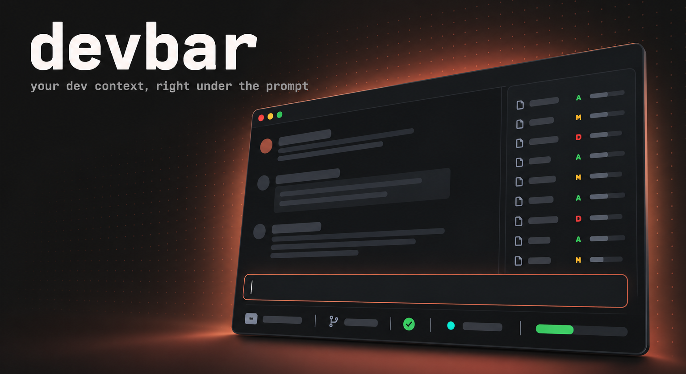
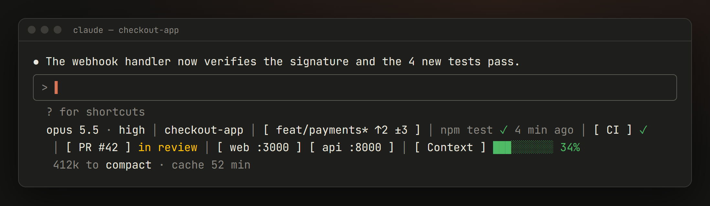
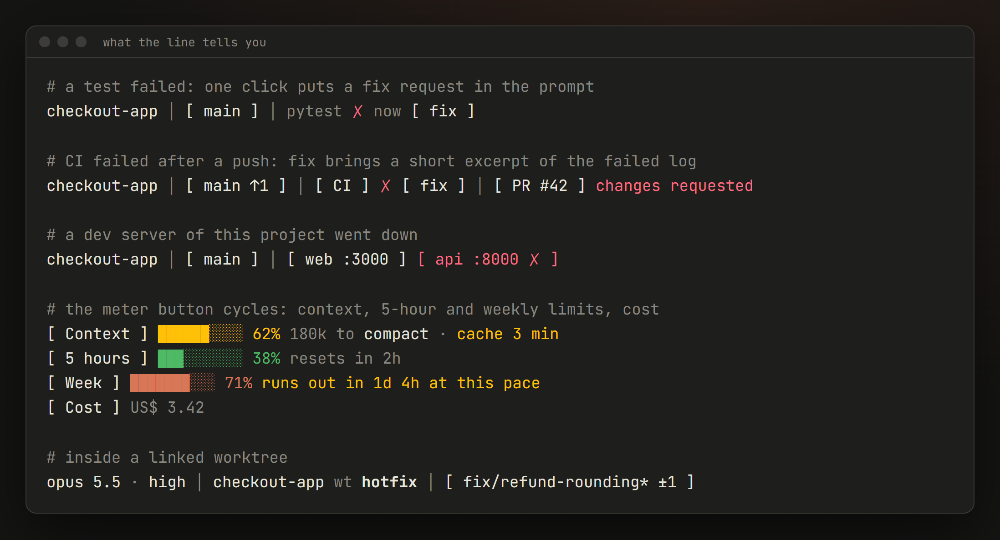
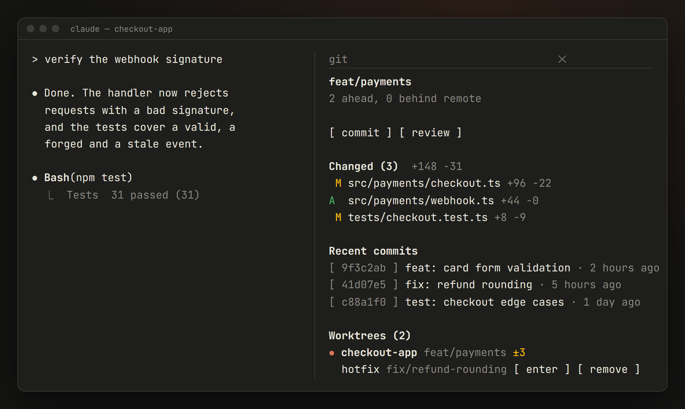

<div align="center">

**English** · [Português](README.pt-BR.md)



An independent [Claude Code](https://docs.anthropic.com/en/docs/claude-code) mod that adds a status line below the prompt box (model, git, last test, CI, pull request, your project's dev servers, context and usage limits) and a git side panel with one-click actions.


[What you get](#what-you-get) · [Install](#install) · [Configure](#configure) · [Safety](#safety-and-privacy) · [Platforms](#platforms) · [FAQ](#faq)

</div>

<br>



## Why

Working with Claude Code, the questions you keep asking are always the same: *which branch am I on, did the tests pass, is CI green, is the dev server still up, how much context is left before it compacts, is the prompt cache still warm?* devbar answers all of them in one line that stays under the prompt, and it never needs a turn of the model to do it.

## What you get

### The status line

| Item | What it shows | Click |
| --- | --- | --- |
| **Model** | `opus 5.5 · high`: the model and the reasoning effort of the last answer | The model puts `/model` in the prompt, the effort puts `/effort` |
| **Task** | The task Claude is working on right now, from its todo list | |
| **Project** | The folder name; inside a linked worktree, `repo wt name` | Copies the folder's full path |
| **Git** | `branch* ↑ahead ↓behind ±changed` | Opens the git panel |
| **Last test** | The last test, build, typecheck or lint Claude ran, ✓ or ✗, and how long ago | `fix` on a failure puts a fix request in the prompt |
| **CI** | GitHub Actions for the current branch: running `…`, passed ✓, failed ✗. After a `git push` it keeps watching and shows a toast when the run ends | Copies the run link. `fix` on a failure puts a request with a short excerpt of the failed log in the prompt |
| **Pull request** | `PR #42` and its review state: in review, approved, changes requested, draft (off by default) | Copies the PR link |
| **Ports** | The dev servers started from *this* project and its Docker Compose services, labeled `web`/`api` when it can tell. A server that goes down turns red and you get a toast | Copies `http://localhost:<port>` |
| **Meter** | Context used (with the part Claude Code reserves for auto-compact taken out), tokens left before it compacts and how long the prompt cache stays warm | Cycles through context, 5-hour limit, weekly limit and session cost. `compact` puts `/compact` in the prompt |



A few things it does on its own:

- **Warns before the wall.** When a usage limit is above 80%, or would run out before it resets at the current pace, the meter switches to it by itself and says when it runs out. When the context passes 80% you get a toast.
- **Knows when the cache goes cold.** The cache time turns yellow in its last 5 minutes: the next message after that pays for the whole context again.
- **Follows you.** `/cd` into another folder or worktree and the line updates right away, no new message needed.

### The git panel

Click the branch to open it next to the conversation.



- **Branch and sync** with the remote, and a merge, rebase, cherry-pick or revert in progress (a rebase with its step, `3/7`).
- **Changed files** with their `+added −removed` lines, conflicts first.
- **Recent commits**: click a hash to copy it.
- **Worktrees**, when the repo has more than one: the current one marked, changes per worktree, locked and stale ones flagged.
- **Buttons**: `commit`, `review`, `enter` a worktree (`/cd` to it), `remove` a worktree and `prune stale` ones.

### Buttons only fill the prompt

Every action button writes a prompt into the input box and stops there. **Nothing is sent and nothing runs until you press Enter**, so you can read it, change it or delete it. Their text is yours to change too: everyone has their own workflow, so every one of them can be rewritten in `/config` (see [Prompts](#prompts)).

## Install

> [!NOTE]
> devbar is built on Claude Code **mods** (function hooks), an API that is in early access. You need a Claude Code version that has it, and the API may still change.

### From the marketplace

In Claude Code:

```text
/plugin install devbar --marketplace Mateus-Fagundes/claude-devbar
```

### From a local clone

```bash
git clone https://github.com/Mateus-Fagundes/claude-devbar
```

Then point Claude Code at the folder in the `env` of your `~/.claude/settings.json`:

```json
{
  "env": {
    "CLAUDE_CODE_PLUGIN_DIRS": "/path/to/claude-devbar"
  }
}
```

The folder is watched: saving a file reloads the mod in the open sessions.

### Optional tools

devbar uses what you already have and hides what it cannot read:

| Tool | Used for |
| --- | --- |
| `git` | Branch, changes, commits, worktrees |
| [`gh`](https://cli.github.com/), logged in | CI and pull request |
| `docker` | Docker Compose services and their ports |

## Configure

Everything is in `/config`, under devbar.

| Option | Default | |
| --- | --- | --- |
| Show model, git, last test, CI, ports | on | Each item can be turned off; an item that is off runs nothing |
| Show pull request | off | Needs `gh` |
| Language | `auto` | English or Portuguese; `auto` follows the system language |
| Prompt cache TTL | `1h` | Claude Code does not tell mods how long your prompt cache lasts: `1h` on most subscriptions, `5m` on API keys |
| Plain buttons | per group | Turn the `[ ]` brackets off or on per group of buttons: model, effort, folder, branch, ports, CI, PR, fix, meter, compact, panel actions, commit hashes. Model, effort, folder and compact come without brackets, so they read as text; the rest have them |

### Prompts

Every button that fills the prompt has its text in `/config`. Leave it empty to use the built-in one.

| Button | Built-in text | Variables |
| --- | --- | --- |
| `commit` | Commit the current changes, following the project's `git log` convention, splitting unrelated changes and asking before including files that look accidental | |
| `review` | `/code-review high` | |
| `fix` (test) | `` `{command}` failed. Find the cause and fix it. `` | `{command}` |
| `fix` (CI) | CI failed on the current branch: read the log with `gh run view --log-failed`, find the cause and fix it (plus a short excerpt of the log) | |
| `compact` | `/compact` | |
| model | `/model` | |
| effort | `/effort` | |
| `enter` | `/cd {path}` | `{path}`, `{worktree}` |
| `remove` | Remove the worktree with `git worktree remove`, checking first for uncommitted or unpushed work, never with `--force` | `{worktree}` |
| `prune stale` | Show what `git worktree prune --dry-run` would prune, then prune if you agree | |

## Safety and privacy

devbar reads, it does not write. It runs these programs, with arguments fixed in the code, and only for the items that are on:

| Program | Why |
| --- | --- |
| `git` (`status`, `log`, `diff --numstat`, `rev-parse`, `symbolic-ref`, `worktree list`, `config --get-regexp`) | Git item and panel |
| `gh` (`run list`, `run view --log-failed`, `pr view`) | CI and pull request |
| `docker ps` | Compose services |
| `netstat` and PowerShell `Get-CimInstance` on Windows; `lsof`, `ss` and `ps` on macOS and Linux | Which ports belong to processes started from the project |
| PowerShell `Get-UICulture` on Windows | System language, once per session (with `language: auto`) |

Opening a repository you did not write should not run its code, so devbar treats what comes from the repo as untrusted:

- **No repo-defined programs.** A repo can configure git to run a program on every `git status` (content filters). devbar checks the repo's config first and, if it finds one, shows only the branch and a warning. It also turns off `core.fsmonitor` and external diff and textconv drivers.
- **No planted executables.** On Windows a program name is looked up in the current folder first, so a `git.exe` inside the repo could run instead of the real one. devbar resolves each program's full path from outside the repo.
- **Network paths left alone.** Worktrees on a network share are listed but never touched (on Windows, touching one can leak your login hash).
- **Clean text.** Branch names, file names and commit messages are stripped of control and invisible characters before they are drawn, and nothing from the repo goes into a prompt except what you can see before sending it.
- **Your data stays here.** No telemetry, no requests of its own. CI and PR data come from your own `gh`.

## Platforms

| | Status |
| --- | --- |
| **Windows** | Tested daily |
| **macOS** | Not tested yet: written for it (`lsof`, `ps`, `LANG`, decomposed Unicode paths); the `lsof` and `ps` parsers are tested against real Linux output |
| **Linux** | Not tested yet: written for it (`ss`, `lsof`, `ps`, `LANG`); its parsers are tested against real Linux output |

If you run it on macOS or Linux, an issue saying whether it works (or what broke) helps a lot.

## FAQ

<details>
<summary><b>Does it replace my <code>statusLine</code>?</b></summary>

No. It draws its own line under the prompt and leaves the official `statusLine` alone. You can keep both, or turn yours off if devbar already shows what you need.
</details>

<details>
<summary><b>Why is a port of my project missing?</b></summary>

A server counts as the project's when its command line mentions a path inside the project folder. A command started with only relative arguments (`uvicorn main:app`) does not mention one, so it does not show up. Docker Compose services always show, since Compose labels them with the project folder.
</details>

<details>
<summary><b>Why is the cache time a setting?</b></summary>

Claude Code does not expose to mods how long the prompt cache lasts on your account. Pick `1h` or `5m` to match it; the timer counts from the end of the last model call.
</details>

<details>
<summary><b>The branch shows ⚠ and the panel is almost empty.</b></summary>

The repository defines content filters in its own `.git/config`, which would run a program on every `git status`. devbar does not read the status of such a repo. Check `.git/config` before trusting it.
</details>

<details>
<summary><b>Does it slow Claude Code down?</b></summary>

No. Everything is read in the background after each turn, never during one, and a failed read just hides its item.
</details>

## Development

```bash
npx -y -p typescript@5 tsc -p .     # types
claude plugin validate .            # manifest, hooks, what the engine would refuse
claude plugin test .                # tests in the mod environment
```

In a fresh clone, `tsc` fails until the mod has loaded once: Claude Code generates the API types into `.claude-plugin/types/` when it loads the mod.

## License

[MIT](LICENSE)

<sub>devbar is an independent project. It is not made, endorsed or supported by Anthropic, and has no affiliation with Anthropic or Claude. Claude and Claude Code are trademarks of Anthropic.</sub>
