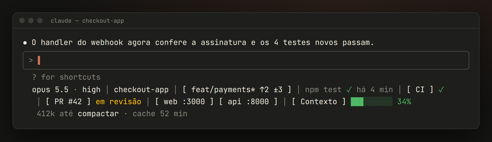
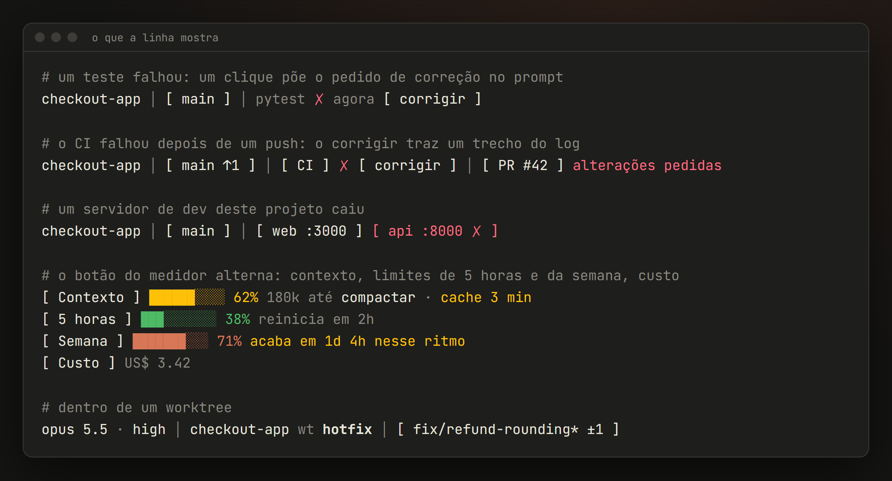
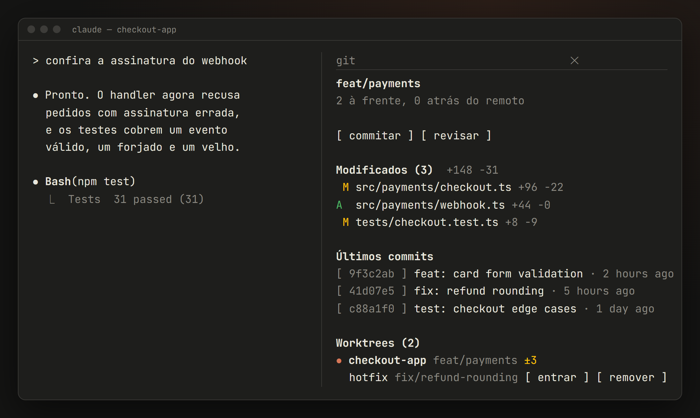

<div align="center">

[English](README.md) · **Português**


Um mod independente para o [Claude Code](https://docs.anthropic.com/en/docs/claude-code) que põe uma linha de status abaixo da caixa do prompt (modelo, git, último teste, CI, pull request, os servidores de dev do seu projeto, contexto e limites de uso) e um painel lateral de git com ações de um clique.


[O que vem](#o-que-vem) · [Instalação](#instalação) · [Configuração](#configuração) · [Segurança](#segurança-e-privacidade) · [Plataformas](#plataformas) · [Dúvidas](#dúvidas-comuns)

</div>

<br>



## Por quê

Trabalhando com o Claude Code, as perguntas que você faz são sempre as mesmas: *em que branch estou, os testes passaram, o CI está verde, o servidor de dev ainda está de pé, quanto contexto falta até compactar, o cache do prompt ainda está quente?* O devbar responde todas numa linha que fica abaixo do prompt, sem precisar de um turno do modelo para isso.

## O que vem

### A linha de status

| Item | O que mostra | Clique |
| --- | --- | --- |
| **Modelo** | `opus 5.5 · high`: o modelo e o esforço de raciocínio da última resposta | O modelo põe `/model` no prompt, o esforço põe `/effort` |
| **Tarefa** | A tarefa em que o Claude está trabalhando agora, da lista de tarefas dele | |
| **Projeto** | O nome da pasta; dentro de um worktree, `repo wt nome` | Copia o caminho completo da pasta |
| **Git** | `branch* ↑à frente ↓atrás ±modificados` | Abre o painel do git |
| **Último teste** | O último teste, build, typecheck ou lint que o Claude rodou, ✓ ou ✗, e há quanto tempo | `corrigir`, numa falha, põe um pedido de correção no prompt |
| **CI** | GitHub Actions do branch atual: rodando `…`, passou ✓, falhou ✗. Depois de um `git push`, continua acompanhando e avisa quando a execução termina | Copia o link da execução. `corrigir`, numa falha, põe no prompt um pedido com um trecho curto do log da falha |
| **Pull request** | `PR #42` e o estado da revisão: em revisão, aprovado, alterações pedidas, rascunho (desligado por padrão) | Copia o link do PR |
| **Portas** | Os servidores de dev iniciados a partir *deste* projeto e os serviços do Docker Compose dele, com o rótulo `web`/`api` quando dá para saber. Um servidor que cai fica vermelho e você recebe um aviso | Copia `http://localhost:<porta>` |
| **Medidor** | Contexto usado (sem a parte que o Claude Code reserva para o autocompact), tokens até compactar e quanto tempo o cache do prompt fica quente | Alterna entre contexto, limite de 5 horas, limite da semana e custo da sessão. `compactar` põe `/compact` no prompt |



Algumas coisas ele faz sozinho:

- **Avisa antes do limite.** Quando um limite de uso passa de 80%, ou vai acabar antes de reiniciar no ritmo atual, o medidor troca para ele sozinho e diz quando acaba. Quando o contexto passa de 80%, você recebe um aviso.
- **Sabe quando o cache esfria.** O tempo do cache fica amarelo nos últimos 5 minutos: a próxima mensagem depois disso paga o contexto inteiro de novo.
- **Acompanha você.** Use `/cd` para outra pasta ou worktree e a linha atualiza na hora, sem mandar mensagem.

### O painel do git

Clique no branch para abrir o painel ao lado da conversa.



- **Branch e sincronia** com o remoto, e um merge, rebase, cherry-pick ou revert em andamento (o rebase com o passo, `3/7`).
- **Arquivos modificados** com as linhas `+adicionadas −removidas`, conflitos primeiro.
- **Últimos commits**: clique num hash para copiar.
- **Worktrees**, quando o repo tem mais de um: o atual marcado, mudanças por worktree, travados e abandonados sinalizados.
- **Botões**: `commitar`, `revisar`, `entrar` num worktree (`/cd` para ele), `remover` um worktree e `limpar abandonados`.

### Os botões só preenchem o prompt

Todo botão de ação escreve um texto na caixa do prompt e para por aí. **Nada é enviado e nada roda até você apertar Enter**, então dá para ler, mudar ou apagar. O texto também é seu: cada pessoa tem seu jeito de trabalhar, por isso todos podem ser reescritos no `/config` (veja [Textos dos botões](#textos-dos-botões)).

## Instalação

> [!NOTE]
> O devbar usa os **mods** do Claude Code (function hooks), uma API em early access. Você precisa de uma versão do Claude Code que já tenha essa API, e ela ainda pode mudar.

### Pelo marketplace

No Claude Code:

```text
/plugin install devbar --marketplace Mateus-Fagundes/claude-devbar
```

### A partir de um clone

```bash
git clone https://github.com/Mateus-Fagundes/claude-devbar
```

Depois, aponte o Claude Code para a pasta no `env` do seu `~/.claude/settings.json`:

```json
{
  "env": {
    "CLAUDE_CODE_PLUGIN_DIRS": "/caminho/para/claude-devbar"
  }
}
```

A pasta é observada: salvar um arquivo recarrega o mod nas sessões abertas.

### Programas opcionais

O devbar usa o que você já tem e esconde o que não consegue ler:

| Programa | Para quê |
| --- | --- |
| `git` | Branch, mudanças, commits, worktrees |
| [`gh`](https://cli.github.com/), com login feito | CI e pull request |
| `docker` | Serviços do Docker Compose e as portas deles |

## Configuração

Tudo fica no `/config`, em devbar. Lá, os nomes das opções aparecem em inglês, como entre parênteses abaixo.

| Opção | Padrão | |
| --- | --- | --- |
| Mostrar modelo, git, último teste, CI, portas (`Show ...`) | ligado | Cada item pode ser desligado; um item desligado não roda nada |
| Mostrar pull request (`Show pull request`) | desligado | Precisa do `gh` |
| Idioma (`Language`) | `auto` | Inglês ou português; `auto` segue o idioma do sistema |
| TTL do cache do prompt (`Prompt cache TTL`) | `1h` | O Claude Code não informa aos mods quanto tempo dura o cache do prompt: `1h` na maioria das assinaturas, `5m` em chave de API |
| Botões sem colchetes (`Plain ... button`) | por grupo | Liga ou desliga os colchetes `[ ]` por grupo de botões: modelo, esforço, pasta, branch, portas, CI, PR, corrigir, medidor, compactar, ações do painel, hashes dos commits. Modelo, esforço, pasta e compactar vêm sem colchetes, para se lerem como texto; os outros vêm com |

### Textos dos botões

Todo botão que preenche o prompt tem o texto no `/config` (`... prompt`). Deixe vazio para usar o padrão do idioma.

| Botão | Texto padrão | Variáveis |
| --- | --- | --- |
| `commitar` | Fazer o commit das mudanças atuais seguindo o padrão do `git log` do projeto, separando mudanças sem relação e perguntando antes de incluir arquivos que pareçam acidentais | |
| `revisar` | `/code-review high` | |
| `corrigir` (teste) | `` O `{command}` falhou. Investiga a causa e corrige. `` | `{command}` |
| `corrigir` (CI) | O CI do branch atual falhou: ler o log com `gh run view --log-failed`, achar a causa e corrigir (mais um trecho curto do log) | |
| `compactar` | `/compact` | |
| modelo | `/model` | |
| esforço | `/effort` | |
| `entrar` | `/cd {path}` | `{path}`, `{worktree}` |
| `remover` | Remover o worktree com `git worktree remove`, conferindo antes se há trabalho sem commit ou sem push, nunca com `--force` | `{worktree}` |
| `limpar abandonados` | Mostrar o que o `git worktree prune --dry-run` limparia e limpar se você concordar | |

## Segurança e privacidade

O devbar lê, não escreve. Ele roda estes programas, com argumentos fixos no código, e só para os itens ligados:

| Programa | Por quê |
| --- | --- |
| `git` (`status`, `log`, `diff --numstat`, `rev-parse`, `symbolic-ref`, `worktree list`, `config --get-regexp`) | Item do git e painel |
| `gh` (`run list`, `run view --log-failed`, `pr view`) | CI e pull request |
| `docker ps` | Serviços do Compose |
| `netstat` e o `Get-CimInstance` do PowerShell no Windows; `lsof`, `ss` e `ps` no macOS e no Linux | Quais portas são de processos iniciados a partir do projeto |
| `Get-UICulture` do PowerShell no Windows | Idioma do sistema, uma vez por sessão (com `Language` em `auto`) |

Abrir um repositório que não é seu não deveria rodar o código dele, então o devbar trata o que vem do repo como não confiável:

- **Nenhum programa definido pelo repo.** Um repo pode configurar o git para rodar um programa a cada `git status` (filtros de conteúdo). O devbar confere o config do repo antes e, se achar um, mostra só o branch e um aviso. Ele também desliga o `core.fsmonitor` e os drivers externos de diff e de textconv.
- **Nenhum executável plantado.** No Windows, um nome de programa é procurado primeiro na pasta atual, então um `git.exe` dentro do repo poderia rodar no lugar do verdadeiro. O devbar descobre o caminho completo de cada programa fora do repo.
- **Pastas de rede ficam de fora.** Worktrees numa pasta de rede aparecem na lista, mas nunca são acessados (no Windows, acessar uma pode vazar o hash do seu login).
- **Texto limpo.** Nomes de branch, nomes de arquivo e mensagens de commit perdem os caracteres de controle e invisíveis antes de serem desenhados, e nada do repo entra num prompt além do que você vê antes de enviar.
- **Seus dados ficam aqui.** Sem telemetria e sem requisições próprias. Os dados de CI e PR vêm do seu próprio `gh`.

## Plataformas

| | Estado |
| --- | --- |
| **Windows** | Testado no uso diário |
| **macOS** | Ainda não testado: feito pensando nele (`lsof`, `ps`, `LANG`, caminhos com Unicode decomposto); os parsers de `lsof` e `ps` são testados com saída real do Linux |
| **Linux** | Ainda não testado: feito pensando nele (`ss`, `lsof`, `ps`, `LANG`); os parsers são testados com saída real do Linux |

Se você rodar no macOS ou no Linux, uma issue dizendo se funciona (ou o que quebrou) ajuda muito.

## Dúvidas comuns

<details>
<summary><b>Ele substitui a minha <code>statusLine</code>?</b></summary>

Não. Ele desenha a própria linha abaixo do prompt e não mexe na `statusLine` oficial. Dá para manter as duas, ou desligar a sua se o devbar já mostra o que você precisa.
</details>

<details>
<summary><b>Por que uma porta do meu projeto não aparece?</b></summary>

Um servidor conta como do projeto quando a linha de comando dele cita um caminho dentro da pasta do projeto. Um comando iniciado só com argumentos relativos (`uvicorn main:app`) não cita nenhum, então não aparece. Os serviços do Docker Compose sempre aparecem, porque o Compose os marca com a pasta do projeto.
</details>

<details>
<summary><b>Por que o tempo do cache é uma opção?</b></summary>

O Claude Code não informa aos mods quanto tempo dura o cache do prompt na sua conta. Escolha `1h` ou `5m` conforme o seu caso; o tempo conta do fim da última chamada ao modelo.
</details>

<details>
<summary><b>O branch aparece com ⚠ e o painel quase vazio.</b></summary>

O repositório define filtros de conteúdo no próprio `.git/config`, que rodariam um programa a cada `git status`. O devbar não lê o status de um repo assim. Confira o `.git/config` antes de confiar nele.
</details>

<details>
<summary><b>Ele deixa o Claude Code mais lento?</b></summary>

Não. Tudo é lido em segundo plano depois de cada turno, nunca durante, e uma leitura que falha só esconde o item dela.
</details>

## Desenvolvimento

```bash
npx -y -p typescript@5 tsc -p .     # tipos
claude plugin validate .            # manifesto, hooks, o que o engine recusaria
claude plugin test .                # testes no ambiente do mod
```

Num clone novo, o `tsc` falha até o mod ser carregado uma vez: o Claude Code gera os tipos da API em `.claude-plugin/types/` quando carrega o mod.

## Licença

[MIT](LICENSE)

<sub>O devbar é um projeto independente. Não é feito, endossado nem mantido pela Anthropic, e não tem ligação com a Anthropic nem com o Claude. Claude e Claude Code são marcas da Anthropic.</sub>
